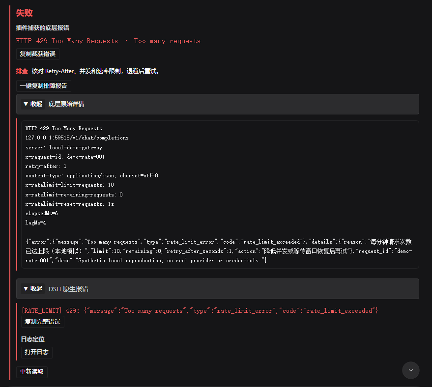

# dsh-better-tips

[English](README_EN.md) | 中文

> [!IMPORTANT]
> 这是独立开发的社区插件，不是 DeepSeek 官方发布、维护或背书的插件。它不会修改 DeepSeek Harness 的核心代码。

>> 已支持：<br>
>> DSH 版本：`>=0.2.2-rc.2 <0.3.0`（`0.2.2-rc.3` 已实测）<br>
>> Node.js：`>=24.9.0`<br>
>> 操作系统：`Windows` & `Linux` & `macOS`
>
> 若有尚未兼容的平台或上游报错格式需要适配，欢迎提交 issue。<br>
> *如果该插件帮上你的忙了，还请点颗星让更多人看见~非常感谢 Thanks♪(･ω･)ﾉ*

**dsh-better-tips** 是一个零配置的 DeepSeek Harness (DSH) 错误诊断与重试增强插件，直接解决底层网络异常、网关响应头和完整报错正文在经过 `pi-ai` 适配层后被裁剪成笼统报错（如 `[TRANSPORT] Connection error.`）的问题。

## 目录

- [它旨在解决什么问题？](#它旨在解决什么问题)
- [实机效果展示](#实机效果展示)
- [快速开始 & 安装指南](#快速开始--安装指南)
- [为什么需要 dsh-better-tips？](#为什么需要-dsh-better-tips)
  - [链路痛点对比](#链路痛点对比)
  - [核心能力](#核心能力)
- [配置说明](#配置说明)
- [隐私与安全边界](#隐私与安全边界)
- [开发验证与开源协议](#开发验证与开源协议)

---

## 它旨在解决什么问题？

在 DSH 接入各类模型与网关时，底层网络异常、网关报错或自动上下文压缩失败，往往被 SDK 裁剪成笼统的错误提示（如 `[TRANSPORT] Connection error.`），导致无法定位根因。本插件在**不修改 DSH 核心代码与原生行为**的前提下，提供：

- **深度网络诊断与报错还原**：即时还原 Socket Cause 链、完整 HTTP 响应头与 JSON 正文，直接在主显示区域呈现完整排障线索。
- **智能重试与自动降级**：针对网络波动提供双预算有界自动重试；当无有效网络证据时自动退让至 DSH 原生展示。
- **上下文压缩状态追踪**：将静默失败的自动压缩（`/compact`）完整投影至对话流，展示每次尝试的底层证据。
- **一键复制排障报告**：自动脱敏并生成结构化诊断信息，直接粘贴即可用于工单或 AI 调试。
- **历史记录精简与日志直达**：自动收纳重复报错流；通过 `seq` 坐标实现原始会话日志的一键直达与源码级定位。

---

## 实机效果展示

> *以下为本地脱敏复现环境下的真实渲染效果。*

### 1. 默认清爽收起态与折叠控制


默认仅展示底层错误短预览与一行排查建议；「底层原始详情」与「DSH 原生报错」同级并列折叠。当前最后一条报错也支持手动收起，折叠后以红字显示 **「最新的报错」**。

### 2. 场景 A：连接中断（还原 Socket Cause 链）


原生报错仅有 `[TRANSPORT] Connection error.`；插件向上提炼 `[UND_ERR_SOCKET] other side closed`，并在详情中完整保留 `TypeError: fetch failed` → `SocketError: other side closed`。

### 3. 场景 B：HTTP 429 限流（保留响应头与顶层字段）



突破 OpenAI SDK 只读取 `errorResponse.error` 的限制，完整保留 `retry-after`、`x-ratelimit-*`、`x-request-id` 响应头及 JSON 顶层 `details` 字段。

### 4. 场景 C：HTTP 502 网关故障（透视代理与上游根因）


捕获 `server`、`via`、`x-request-id` 网关头与顶层上游连接拒绝详情（`connect ECONNREFUSED 192.0.2.10:443`），快速区分网关故障与源站宕机。

---

## 快速开始 & 安装指南

插件开箱即用，零配置即可生效。

### 1. 图形界面安装（推荐）
打开 DSH 的 **Plugins（插件管理）** -> **Add plugin（添加插件）**，输入仓库地址或包名：

```text
https://github.com/HakureiMonika/dsh-better-tips
```

### 2. 命令行安装
```sh
# 通过 npm 安装
dsh plugin add dsh-better-tips

# 或通过 GitHub 仓库安装
dsh plugin add https://github.com/HakureiMonika/dsh-better-tips
```

*(本地开发可直接传入仓库目录的绝对路径)*

---

## 为什么需要 `dsh-better-tips`？

### 链路痛点对比

在 DSH 中，模型请求经过 **Undici / Fetch → OpenAI SDK → `pi-ai` → DSH 会话事件**。当网络波动或网关报错时，关键排障线索往往在半途被丢弃：

| 故障场景 | DSH 原生显示 | 上游丢失的信息 | 本插件还原效果 |
| :--- | :--- | :--- | :--- |
| **TCP / TLS 连接中断** | `[TRANSPORT] Connection error.` | DNS 失败、连接被拒、证书过期还是对端关闭？ | 还原完整 `cause` 链（如 `SocketError: other side closed [UND_ERR_SOCKET]`） |
| **HTTP 429 速率限制** | 仅保留 `error` 嵌套短文本 | 剩余配额、重置时间、请求 ID 与顶层 `details` | 保留 `retry-after`、`x-ratelimit-*`、`x-request-id` 响应头与完整 JSON 正文 |
| **HTTP 502 / 504 网关异常** | 简短状态码或 `Bad gateway` | 边缘网关断连还是上游源站拒绝连接？ | 展示 `server`、`via` 等网关头与顶层上游诊断（如 `connect ECONNREFUSED`） |
| **上下文压缩 (`/compact`) 失败** | 手动压缩仅有一句通用提示；自动压缩静默失败 | 哪个模型失败？耗时多久？重试了几次？ | 在对话流内联渲染压缩失败卡片，附带模型、Token 用量与底层网络证据 |
| **连续报错与重试刷屏** | 多条报错堆叠，难以分辨最新状态 | 连续同码同文报错分别对应哪次底层请求？ | 历史报错自动折叠；最新报错支持手动收起并标红显示「最新的报错」 |

### 核心能力

- **非侵入式网络取证与精确关联**：在 `fetch` 与 Node.js `diagnostics_channel` 边界只读捕获异常链、HTTP 响应头、响应体及 SSE 中途断流信息；通过 `AsyncLocalStorage` 与会话日志事件 `seq` 坐标精确绑定每次重试和终止错误，杜绝连续相同报错时的“关联未确认”误判。
- **错误处理与原生退让机制**：当故障不涉及网络请求（如模型工具调用参数 JSON 拼接错误 `MALFORMED_RESPONSE`）或没有已确认属于当前错误的底层捕获时，插件自动退让，**在主区域直接展示完整的 DSH 原生报错与复制入口**，将空诊断状态收进折叠抽屉，绝不遮挡真实病因。
- **双预算有界重试与熔断**：为普通请求与 `/compact` 摘要请求提供独立重试预算（默认各额外重试 2 次），平滑接续官方指数退避曲线并遵循 `Retry-After`；遇到 `AUTH`、`QUOTA`、`CONTEXT_WINDOW_EXCEEDED` 等硬错误立即熔断，不浪费额度。
- **一键脱敏排障报告 & 日志直达**：一键复制包含模型、耗时、底层证据及当前已启用第三方插件清单的纯文本报告；点击「打开日志」可按 `seq` 惰性查看原始会话事件与日志文件物理路径。
- **中英界面语言自动跟随**：自动跟随 DSH 当前界面语言（中文 DSH 显示中文，英文 DSH 显示英文），已挂载卡片、排查建议、折叠按钮与报告日期格式实时同步切换；上游原始错误正文、响应体与错误码保持原样不翻译，确保证据纯粹。

---

## 配置说明

如需调整重试次数或捕获范围，可在 Profile 的 `cordis.patch.yml` 中配置（仅需诊断展示而不需额外重试时，将两个重试项设为 `0` 即可避免额外 API 调用费用）：

```yaml
- insert:
    - id: better-tips
      name: dsh-better-tips
      config:
        enabled: true              # 插件 Host 总开关
        extraRetries: 2            # 普通请求每步额外重试次数（0–20，0 为不介入重试）
        compactionRetries: 2       # 上下文压缩 (/compact) 额外重试次数（0–10）
        initialDelayMs: 1000       # 起步退避等待毫秒数（官方已重试过则接续其退避曲线）
        maxDelayMs: 20000          # 单次重试最大等待毫秒数上限（含 Retry-After）
        jitterRatio: 0.2           # 退避延迟对称抖动比例（0–1）
        retryableCodes:            # 允许接管重试的错误码（硬拒绝码始终优先熔断）
          - PI_AI_ERROR
          - TRANSPORT
          - TIMEOUT
          - SERVER
          - EMPTY_RESPONSE
          - RATE_LIMIT
        captureDetails: true       # 是否捕获底层网络证据
        captureHosts: []           # 仅捕获指定主机列表；留空捕获全部主机
```

---

## 隐私与安全边界

1. **只读采集，零敏感请求入库**：绝不记录 Prompt 请求体、请求头、`Authorization`、`Cookie`、URL Query 参数或成功响应正文。
2. **全出口凭据过滤与 AUTH 强保护**：自动抹除 `Bearer ...`、`sk-...`、`api_key=`、`token:`、`secret=` 等常见凭据形状；识别到 `AUTH` 错误码时自动隐藏原始错误正文与响应体。
3. **有界内存生命周期**：网络捕获仅保存在 Host 进程有界内存环形缓冲区中（默认最多 100 条），进程退出即销毁。

> ⚠️ **分享提醒**：正则过滤无法替代人工检查。错误或响应仍可能回显您的输入内容，分享排障报告前请先核对。

---

## 开发验证与开源协议

```sh
npm run check   # 语法与模块静态检查
npm test        # 运行全部 240 项离线契约与回归测试
```

本项目基于 [MIT License](LICENSE) 开源。欢迎提交 [Issue](https://github.com/HakureiMonika/dsh-better-tips/issues) 或 Pull Request。
