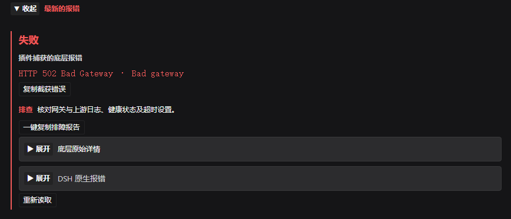
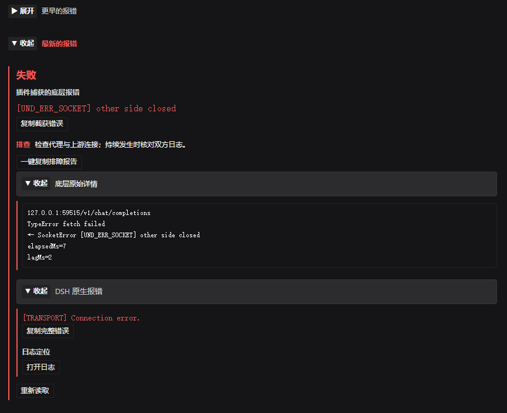
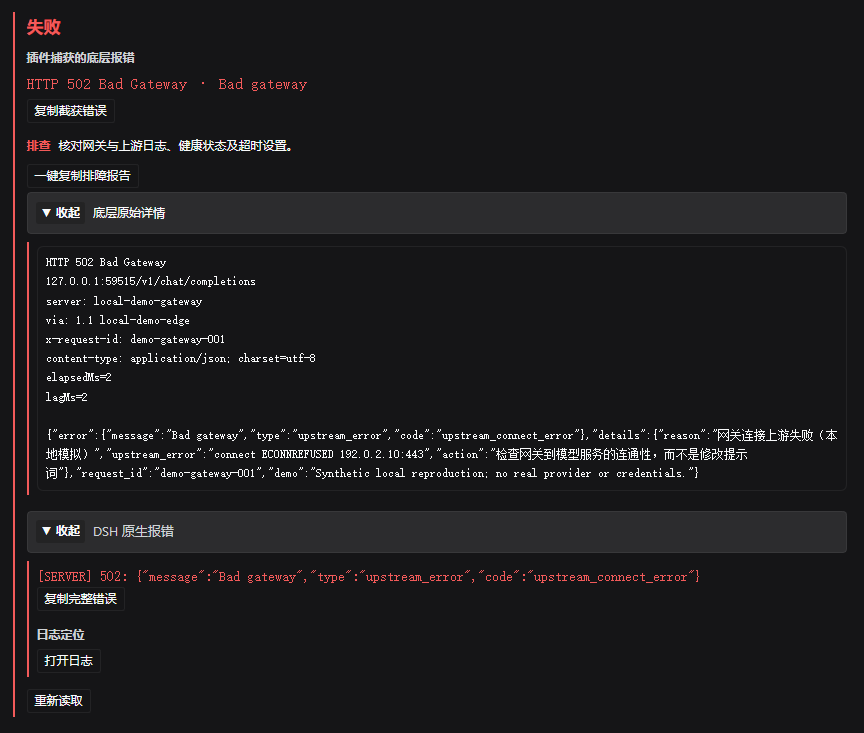

# dsh-better-tips

[English](README_EN.md) | 中文

> [!IMPORTANT]
> 这是独立开发的社区插件，不是 DeepSeek 官方发布、维护或背书的插件。它不会修改 DeepSeek Harness 的核心代码。

>> 已支持：<br>
>> DSH 版本：`>=0.2.2-rc.2 <0.3.0`（`0.2.2-rc.3` 已实测）<br>
>> Node.js：`>=24.9.0`<br>
>> 操作系统：Windows 已实测；Linux、macOS 预期兼容，尚未实测
>
> 若有尚未兼容的平台或上游报错格式需要适配，欢迎提交 issue。<br>
> *如果该插件帮上你的忙了，还请点颗星让更多人看见~非常感谢 Thanks♪(･ω･)ﾉ*

**dsh-better-tips** 是一个零配置的 DeepSeek Harness (DSH) 错误诊断与重试增强插件，直接解决底层网络异常、关键响应头和错误正文在经过 `pi-ai` 适配层后被裁剪成笼统报错（如 `[TRANSPORT] Connection error.`）的问题。

## 目录

- [它旨在解决什么问题？](#它旨在解决什么问题)
- [常见报错对照](#常见报错对照)
- [实机效果展示](#实机效果展示)
- [快速开始 & 安装指南](#快速开始--安装指南)
- [为什么需要 dsh-better-tips？](#为什么需要-dsh-better-tips)
  - [链路痛点对比](#链路痛点对比)
  - [核心能力](#核心能力)
- [配置说明](#配置说明)
- [隐私与安全边界](#隐私与安全边界)
- [开发验证与开源协议](#开发验证与开源协议)

---

## 它旨在解决什么问题？

在 DSH 中，连接失败、网关报错和压缩失败常常缺少足够的排查信息。本插件不修改 DSH 核心文件，通过插件扩展错误展示与重试行为，提供：

- **更清楚的报错与排查建议**：显示连接失败、压缩失败等错误，补充异常原因链、关键响应头和错误正文。正文默认最多 4096 字符，超出会标记截断。
- **失败重试与原生退让**：普通请求和压缩请求分别设置额外重试次数；没有有效捕获时，直接显示 DSH 原生报错。
- **上下文压缩状态追踪**：在对话中显示自动与手动压缩失败，以及已取得的尝试记录和诊断信息。
- **一键复制排障报告**：汇总错误和环境信息，过滤常见凭据，便于提交工单或交给 AI 排查。
- **历史收纳与日志切片**：折叠更早的报错，按事件位置查看原始日志及相邻记录；部分已知错误还可查看源码位置参考。

---

## 常见报错对照

下表按 DSH 界面上实际出现的报错原文排列。原始字符串保持英文，方便和日志对上。

| 你看到的报错 | DSH 原生给的信息 | 本插件补充的信息 |
| :--- | :--- | :--- |
| `DeepSeek Messages transport failed`<br>`[TRANSPORT] Connection error.` | 只有这一句 | 异常原因链，如 `TypeError: fetch failed` → `SocketError: other side closed [UND_ERR_SOCKET]`；另多做 2 次有界重试 |
| `fetch failed` / `ECONNRESET` / `ETIMEDOUT` / `ENOTFOUND` | 被折叠成 `TRANSPORT` | 底层 `errno`、卡在哪个阶段、目标主机 |
| `PI_AI_ERROR`（含 `Internal server error`、`exceeded request buffer limit`） | 只有一个错误码 | 上游状态码与响应正文；默认额外重试 2 次 |
| `DeepSeek Messages request failed (400)` / `INVALID_REQUEST` | 只有状态码 | 上游原始响应正文（最多 4096 字符，超出标截断）与 `x-request-id` |
| 403 却显示 `API key invalid` | 固定文案 | 上游真实的 403 正文与 `x-request-id` |
| `429` / `rate limit exceeded` | 只有短文本 | `retry-after`、`x-ratelimit-*`、`x-request-id` 及 JSON 顶层 `details` |
| `502` / `504` / `Bad gateway` / `upstream_unavailable` | 简短状态码 | `server`、`via`、`x-request-id`，以及上游连接拒绝详情 |
| `Compaction could not produce a useful summary.` | 一句通用提示 | 失败的模型、耗时、用量和网络诊断；压缩请求默认额外重试 2 次 |
| `MALFORMED_RESPONSE`（工具参数 JSON 拼接错误） | 原生报错 | 不接管。这类失败不经过网络请求，插件直接完整展示原生报错 |

---

## 实机效果展示

> *以下为本地脱敏复现环境下的真实渲染效果。*

### 1. 默认清爽收起态与折叠控制



默认仅展示底层错误短预览与一行排查建议；「底层原始详情」与「DSH 原生报错」同级并列折叠。当前最后一条报错也支持手动收起，折叠后以红字显示 **「最新的报错」**。

### 2. 场景 A：连接中断（还原 Socket Cause 链）



原生报错仅有 `[TRANSPORT] Connection error.`；插件向上提炼 `[UND_ERR_SOCKET] other side closed`，并在详情中完整保留 `TypeError: fetch failed` → `SocketError: other side closed`。

### 3. 场景 B：HTTP 429 限流（保留响应头与顶层字段）


突破 OpenAI SDK 只读取 `errorResponse.error` 的限制，完整保留 `retry-after`、`x-ratelimit-*`、`x-request-id` 响应头及 JSON 顶层 `details` 字段。

### 4. 场景 C：HTTP 502 网关故障（透视代理与上游根因）



捕获 `server`、`via`、`x-request-id` 网关头与顶层上游连接拒绝详情（`connect ECONNREFUSED 192.0.2.10:443`），快速区分网关故障与源站宕机。

---

## 快速开始 & 安装指南

插件开箱即用，零配置即可生效。

### 1. 图形界面安装（推荐）
打开 DSH 的 **Plugins（插件管理）** -> **Add plugin（添加插件）**，输入仓库地址或包名：

```text
https://github.com/HakureiMonika/dsh-better-tips
```

### 2. 命令行安装
```sh
# 通过 npm 安装
dsh plugin add dsh-better-tips

# 或通过 GitHub 仓库安装
dsh plugin add https://github.com/HakureiMonika/dsh-better-tips
```

*(本地开发可直接传入仓库目录的绝对路径)*

---

## 为什么需要 `dsh-better-tips`？

### 链路痛点对比

以 OpenAI 兼容协议的 `pi-ai` 接入为例，请求经过 **Fetch → OpenAI SDK → `pi-ai` → DSH 会话事件**。网络或网关报错时，部分排障线索会在传递中丢失：

| 故障场景 | DSH 原生显示 | 上游丢失的信息 | 本插件还原效果 |
| :--- | :--- | :--- | :--- |
| **TCP / TLS 连接中断** | `[TRANSPORT] Connection error.` | DNS 失败、连接被拒、证书过期还是对端关闭？ | 还原异常原因链（如 `SocketError: other side closed [UND_ERR_SOCKET]`） |
| **HTTP 429 速率限制** | 仅保留 `error` 嵌套短文本 | 剩余配额、重置时间、请求 ID 与顶层 `details` | 保留关键限流响应头与限长错误正文 |
| **HTTP 502 / 504 网关异常** | 简短状态码或 `Bad gateway` | 边缘网关断连还是上游源站拒绝连接？ | 展示 `server`、`via` 等网关头与顶层上游诊断（如 `connect ECONNREFUSED`） |
| **上下文压缩 (`/compact`) 失败** | 手动压缩仅有一句通用提示；自动压缩静默失败 | 哪个模型失败？耗时多久？重试了几次？ | 在对话中显示压缩失败卡片，附带已取得的模型、用量和网络诊断信息 |
| **连续报错与重试刷屏** | 多条报错堆叠，难以分辨最新状态 | 连续同码同文报错分别对应哪次底层请求？ | 历史报错自动折叠；最新报错支持手动收起并标红显示「最新的报错」 |

### 核心能力

- **网络取证与请求关联**：捕获异常原因链、关键响应头、限长错误正文和流式连接中断信息。按请求身份和日志位置匹配当前报错，无法确认的记录单独标注。
- **错误处理与原生退让机制**：当故障不涉及网络请求（如模型工具调用参数 JSON 拼接错误 `MALFORMED_RESPONSE`）或没有已确认属于当前错误的底层捕获时，插件自动退让，**在主区域直接展示完整的 DSH 原生报错与复制入口**，将空诊断状态收进折叠抽屉，绝不遮挡真实病因。
- **双预算有界重试**：普通请求每步和压缩请求每次默认各额外重试 2 次，等待时间逐次增加。适配器提供重试等待时间时优先采用，但不超过配置上限。插件不重试 `AUTH`、`QUOTA`、`CONTEXT_WINDOW_EXCEEDED` 等错误；其他重试插件的行为不变。
- **一键脱敏排障报告 & 日志直达**：一键复制包含模型、耗时、底层证据及当前已启用第三方插件清单的纯文本报告；点击「打开日志」可按 `seq` 惰性查看原始会话事件与日志文件物理路径。
- **中英界面语言自动跟随**：自动跟随 DSH 当前界面语言（中文 DSH 显示中文，英文 DSH 显示英文），已挂载卡片、排查建议、折叠按钮与报告日期格式实时同步切换；上游原始错误正文、响应体与错误码保持原样不翻译，确保证据纯粹。

---

## 配置说明

如需调整重试次数或捕获范围，在 Profile 的 `cordis.patch.yml` 中覆盖已有插件配置。`config` 会整体替换，请保留需要的配置项。将两个重试项设为 `0` 可关闭本插件的额外重试。

```yaml
- id: better-tips
  name: dsh-better-tips
  config:
    enabled: true              # Host 捕获与重试开关
    extraRetries: 2            # 普通请求每步额外重试（0–20）
    compactionRetries: 2       # 压缩请求额外重试（0–10）
    initialDelayMs: 1000       # 起步等待毫秒数
    maxDelayMs: 20000          # 单次等待上限
    jitterRatio: 0.2           # 等待时间随机浮动比例（0–1）
    retryableCodes:            # 允许额外重试的错误码
      - PI_AI_ERROR
      - TRANSPORT
      - TIMEOUT
      - SERVER
      - EMPTY_RESPONSE
      - RATE_LIMIT
    captureDetails: true       # 捕获底层网络证据
    captureHosts: []           # 指定主机，留空捕获全部
```

---

## 隐私与安全边界

1. **网络捕获范围**：捕获器不主动采集请求正文、请求头、URL 查询参数或成功响应正文。错误正文和相邻日志仍可能包含输入内容。
2. **凭据过滤**：补充诊断、报告和日志显示副本过滤常见凭据，部分认证错误会隐藏正文。原生错误及「复制完整错误」保留原文，分享前请检查。
3. **内存证据**：网络捕获和关联记录限量保存在进程内，退出后无法恢复。已复制的报告与 DSH 原生日志不受影响。

> ⚠️ **分享提醒**：正则过滤无法替代人工检查。错误或响应仍可能回显您的输入内容，分享排障报告前请先核对。

---

## 开发验证与开源协议

```sh
npm run check   # 语法与模块静态检查
npm test        # 运行全部 241 项离线契约与回归测试
```

本项目基于 [MIT License](LICENSE) 开源。欢迎提交 [Issue](https://github.com/HakureiMonika/dsh-better-tips/issues) 或 Pull Request。
