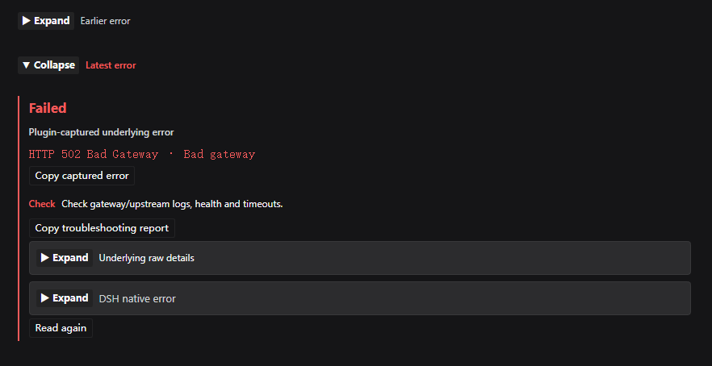
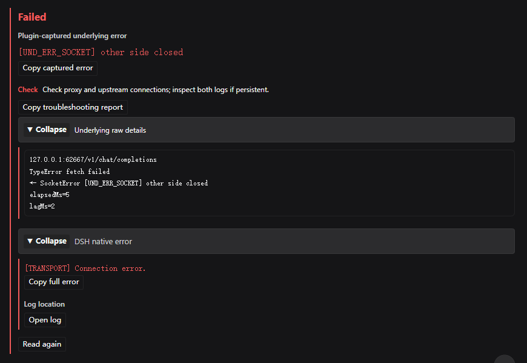
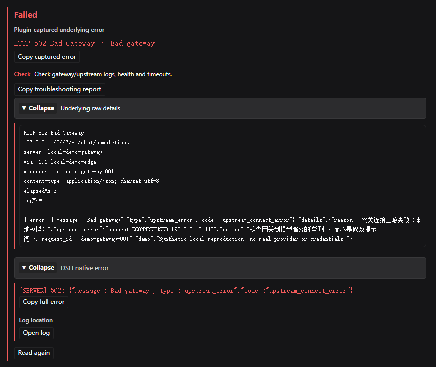

# dsh-better-tips

English | [简体中文](README.md)

> [!IMPORTANT]
> This is an independent community plugin. It is not published, maintained, or endorsed by DeepSeek, and it does not modify DeepSeek Harness core packages.

> Currently supported:<br>
> DSH version: `>=0.2.2-rc.2 <0.3.0` (`0.2.2-rc.3` verified)<br>
> Node.js: `>=24.9.0`<br>
> OS: Windows tested; Linux and macOS expected compatible, not yet tested
>
> If there is any platform or upstream error format that needs compatibility, please submit an issue.<br>
> *If it's useful, please stars let more people can see it~ Thanks♪(･ω･)ﾉ*

**dsh-better-tips** is a zero-configuration error diagnostics and bounded retry plugin for DeepSeek Harness (DSH). It recovers low-level socket cause chains, key response headers, and error bodies that are stripped or flattened into generic messages (like `[TRANSPORT] Connection error.`) by upstream SDKs and `pi-ai`.

## Contents

- [The Problem It Solves](#the-problem-it-solves)
- [Error Reference](#error-reference)
- [Live Examples](#live-examples)
- [Quick Start & Installation](#quick-start--installation)
- [Why dsh-better-tips?](#why-dsh-better-tips)
  - [What Gets Lost Upstream](#what-gets-lost-upstream)
  - [Core Capabilities](#core-capabilities)
- [Configuration](#configuration)
- [Privacy & Security Boundaries](#privacy--security-boundaries)
- [Development & License](#development--license)

---

## The Problem It Solves

Connection, gateway, and compaction failures in DSH often lack useful troubleshooting details. This plugin extends error display and retry behavior without modifying DSH core files:

- **Clearer Errors & Troubleshooting Checks**: Shows connection and compaction failures with cause chains, key response headers, and error bodies. Bodies are capped at 4096 characters by default, with truncation marked.
- **Failure Retries & Native Fallback**: Separate extra-retry budgets for model and compaction requests. When no usable capture exists, the DSH native error is shown directly.
- **Compaction Visibility**: Shows automatic and manual compaction failures in the chat, along with available attempt records and diagnostics.
- **One-Click Troubleshooting Reports**: Summarizes errors and environment details, filters common credential patterns, and copies the report for support tickets or AI debugging.
- **History Folding & Log Slices**: Folds earlier errors and shows the exact log event with nearby records. Source-location references are also available for some known errors.

---

## Error Reference

Rows follow the error text shown in the DSH UI. Strings stay in English so they match your logs.

| Error you see | What DSH shows natively | What the plugin adds |
| :--- | :--- | :--- |
| `DeepSeek Messages transport failed`<br>`[TRANSPORT] Connection error.` | That single line | The cause chain, e.g. `TypeError: fetch failed` → `SocketError: other side closed [UND_ERR_SOCKET]`, plus 2 extra bounded retries |
| `fetch failed` / `ECONNRESET` / `ETIMEDOUT` / `ENOTFOUND` | Flattened into `TRANSPORT` | The underlying `errno`, the failing stage, and the target host |
| `PI_AI_ERROR` (including `Internal server error`, `exceeded request buffer limit`) | Only the error code | Upstream status and response body; 2 extra bounded retries by default |
| `DeepSeek Messages request failed (400)` / `INVALID_REQUEST` | Only the status code | The raw upstream response body (up to 4096 chars, truncation marked) and `x-request-id` |
| A 403 displayed as `API key invalid` | Fixed message | The real 403 body and `x-request-id` |
| `429` / `rate limit exceeded` | Short text only | `retry-after`, `x-ratelimit-*`, `x-request-id`, and top-level `details` |
| `502` / `504` / `Bad gateway` / `upstream_unavailable` | Short status only | `server`, `via`, `x-request-id`, and upstream connection diagnostics |
| `Compaction could not produce a useful summary.` | One generic line | The failing model, duration, usage and network diagnostics; 2 extra bounded retries per compaction |
| `MALFORMED_RESPONSE` (malformed tool-argument JSON) | Native error | Not captured. This failure never reaches the network layer, so the native error is shown in full |

---

## Live Examples

> *Captured from sanitized local reproductions in the real DSH rendering pipeline.*

### 1. Clean Default View & Collapsible Latest Error



Shows a concise underlying headline and one targeted check by default, while keeping **Underlying raw details** and **DSH native error** as independent drawers. Even the latest error can be manually collapsed into a red **Latest error** summary.

### 2. Case A: Connection Drop (Socket Cause Chain Recovery)



Where native DSH only shows `[TRANSPORT] Connection error.`, the plugin surfaces `[UND_ERR_SOCKET] other side closed` and preserves the full `TypeError: fetch failed` → `SocketError: other side closed` chain in raw details.

### 3. Case B: HTTP 429 Rate Limit (Headers & Top-Level JSON)


Recovers top-level JSON fields (`details`, `request_id`) stripped by the OpenAI SDK alongside `retry-after`, `x-ratelimit-*`, and `x-request-id` response headers.

### 4. Case C: HTTP 502 Bad Gateway (Proxy & Upstream Diagnostics)



Exposes `server`, `via`, and `x-request-id` headers plus upstream connection diagnostics (`connect ECONNREFUSED 192.0.2.10:443`) to separate proxy issues from upstream outages.

---

## Quick Start & Installation

Works out of the box with zero configuration.

### 1. Install via DSH GUI (Recommended)
Open **Plugins** -> **Add plugin** in DeepSeek Harness and enter:

```text
https://github.com/HakureiMonika/dsh-better-tips
```

### 2. Install via CLI
```sh
# Install from npm
dsh plugin add dsh-better-tips

# Or install from GitHub
dsh plugin add https://github.com/HakureiMonika/dsh-better-tips
```

*(For local development, pass the absolute local directory path instead.)*

---

## Why `dsh-better-tips`?

### What Gets Lost Upstream

For example, an OpenAI-compatible `pi-ai` connection uses **Fetch → OpenAI SDK → `pi-ai` → DSH Session Events**. Some troubleshooting details can be lost along this path:

| Failure Scenario | What Native DSH Shows | What Gets Lost Upstream | What `dsh-better-tips` Recovers |
| :--- | :--- | :--- | :--- |
| **TCP / TLS Connection Drop** | `[TRANSPORT] Connection error.` | DNS failure, refused port, expired cert, or peer reset? | Captured cause chain (e.g., `SocketError: other side closed [UND_ERR_SOCKET]`) |
| **HTTP 429 Rate Limit** | Only nested `error` message text | Reset timer, quota headers, request ID, and top-level `details` | Key rate-limit headers and a size-limited error body |
| **HTTP 502 / 504 Gateway Error** | Terse status code or `Bad gateway` | Edge proxy failure or upstream origin connection refusal? | Gateway headers (`server`, `via`) and top-level upstream diagnostics (`ECONNREFUSED`) |
| **Context Compaction (`/compact`) Failure** | Generic message on manual `/compact`; silent on auto-compaction | Which model failed? How long did it take? How many retries ran? | Inline failure card with available model, usage, and network diagnostics |
| **Repeated Retry Clutter** | Stacked error rows cluttering the chat stream | Which row is latest? Which capture belongs to which retry attempt? | Auto-folds earlier errors; allows collapsing the latest error into a red **Latest error** label |

### Core Capabilities

- **Network Evidence & Request Matching**: Captures cause chains, key response headers, size-limited error bodies, and stream read failures. Matches errors by request identity and log position, marking unconfirmed records separately.
- **Error Handling & Native Fallback Mechanism**: When an error does not involve a network failure (e.g., malformed tool-call JSON `MALFORMED_RESPONSE`) or has no confirmed capture for the current error, the plugin yields gracefully—**displaying the full DSH native error and copy button directly in the main area** while tucking empty capture states into collapsed details.
- **Separate, Bounded Retry Budgets**: Adds up to 2 retries per model step and 2 per compaction request by default, with increasing delays. Uses adapter-provided retry delays when available, capped by the configured limit. This plugin does not retry `AUTH`, `QUOTA`, or `CONTEXT_WINDOW_EXCEEDED`; other retry plugins remain unchanged.
- **One-Click Redacted Reports & Log Inspector**: Copies a structured plain-text report (with live third-party plugin versions, timing, and evidence) in one click, and lazily loads raw session log events by `seq` along with the physical log file path.
- **Automatic Bilingual UI (Chinese / English)**: Automatically follows the active DSH interface language (Chinese in Chinese DSH, English in English DSH). Mounted error cards, troubleshooting checks, disclosure buttons, and report date formats switch live without a separate setting, while upstream error messages, payloads, and codes remain untranslated as raw evidence.

---

## Configuration

Override the installed plugin's settings in your profile's `cordis.patch.yml`. The entire `config` is replaced, so retain the settings you need. Set both retry budgets to `0` to disable this plugin's extra retries.

```yaml
- id: better-tips
  name: dsh-better-tips
  config:
    enabled: true              # Host capture and retry switch
    extraRetries: 2            # Extra retries per model step (0–20)
    compactionRetries: 2       # Extra retries per compaction request (0–10)
    initialDelayMs: 1000       # Initial delay in ms
    maxDelayMs: 20000          # Maximum wait per retry
    jitterRatio: 0.2           # Random delay variation (0–1)
    retryableCodes:            # Codes eligible for extra retries
      - PI_AI_ERROR
      - TRANSPORT
      - TIMEOUT
      - SERVER
      - EMPTY_RESPONSE
      - RATE_LIMIT
    captureDetails: true       # Capture network evidence
    captureHosts: []           # Selected hosts; empty captures all
```

---

## Privacy & Security Boundaries

1. **Capture Scope**: The recorder does not actively collect request bodies, request headers, URL query strings, or successful response bodies. Error bodies and nearby log events may still contain input text.
2. **Credential Filtering**: Diagnostic output, reports, and log display copies filter common credential patterns. Some authentication errors have their bodies hidden. Native errors and **Copy full error** preserve the original text; review before sharing.
3. **In-Memory Evidence**: Captures and linked records are kept in bounded process memory and cannot be recovered after exit. Copied reports and DSH session logs are unaffected.

> ⚠️ **Sharing Notice**: Pattern redaction does not replace human review. Always check reports for echoed prompt text or personal data before sharing externally.

---

## Development & License

```sh
npm run check   # Syntax and module checks
npm test        # Run all 240 offline contract and regression tests
```

Licensed under the [MIT License](LICENSE). Issues and Pull Requests are welcome at [GitHub Issues](https://github.com/HakureiMonika/dsh-better-tips/issues).
