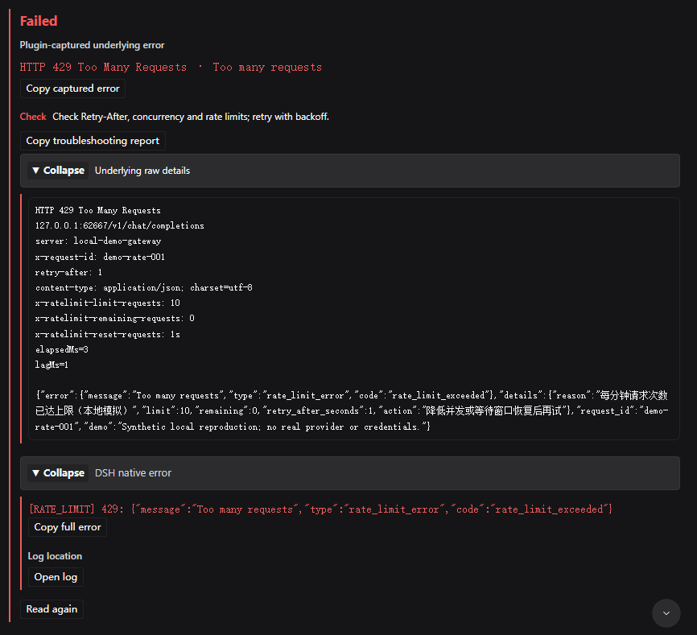

# dsh-better-tips

English | [简体中文](README.md)

> [!IMPORTANT]
> This is an independent community plugin. It is not published, maintained, or endorsed by DeepSeek, and it does not modify DeepSeek Harness core packages.

> Currently supported:<br>
> DSH version: `>=0.2.2-rc.2 <0.3.0` (`0.2.2-rc.3` verified)<br>
> Node.js: `>=24.9.0`<br>
> OS: `Windows` & `Linux` & `macOS`
>
> If there is any platform or upstream error format that needs compatibility, please submit an issue.<br>
> *If it's useful, please stars let more people can see it~ Thanks♪(･ω･)ﾉ*

**dsh-better-tips** is a zero-configuration error diagnostics and bounded retry plugin for DeepSeek Harness (DSH). It recovers low-level socket cause chains, gateway headers, and full error payloads that are stripped or flattened into generic messages (like `[TRANSPORT] Connection error.`) by upstream SDKs and `pi-ai`.

## Contents

- [The Problem It Solves](#the-problem-it-solves)
- [Live Examples](#live-examples)
- [Quick Start & Installation](#quick-start--installation)
- [Why dsh-better-tips?](#why-dsh-better-tips)
  - [What Gets Lost Upstream](#what-gets-lost-upstream)
  - [Core Capabilities](#core-capabilities)
- [Configuration](#configuration)
- [Privacy & Security Boundaries](#privacy--security-boundaries)
- [Development & License](#development--license)

---

## The Problem It Solves

When connecting DSH to model providers or gateways, network drops, rate limits, and proxy failures are often flattened by SDKs and `pi-ai` into generic errors (like `[TRANSPORT] Connection error.`), stripping the critical details needed for troubleshooting. This plugin recovers these diagnostics **without modifying any DSH core packages or original events**:

- **Deep Diagnostics & Evidence Recovery**: Instantly restores socket `cause` chains, raw HTTP response headers, and full JSON payloads, surfacing them directly in the chat stream.
- **Smart Retries & Adaptive Fallback**: Provides bounded, multi-budget automatic retries for transient errors and gracefully falls back to the native DSH error view when no valid network capture exists.
- **Context Compaction (`/compact`) Visibility**: Projects silent auto-compaction failures directly into the chat flow, detailing each attempt’s model, token usage, and network evidence.
- **One-Click Redacted Reports**: Generates structured, sanitized plain-text diagnostic reports on demand for support tickets or AI debugging.
- **Clutter-Free Log Correlation**: Auto-folds repetitive error rows and provides one-click navigation to exact log events via `seq` coordinates and source-function attribution.

---

## Live Examples

> *Captured from sanitized local reproductions in the real DSH rendering pipeline.*

### 1. Clean Default View & Collapsible Latest Error


Shows a concise underlying headline and one targeted check by default, while keeping **Underlying raw details** and **DSH native error** as independent drawers. Even the latest error can be manually collapsed into a red **Latest error** summary.

### 2. Case A: Connection Drop (Socket Cause Chain Recovery)


Where native DSH only shows `[TRANSPORT] Connection error.`, the plugin surfaces `[UND_ERR_SOCKET] other side closed` and preserves the full `TypeError: fetch failed` → `SocketError: other side closed` chain in raw details.

### 3. Case B: HTTP 429 Rate Limit (Headers & Top-Level JSON)



Recovers top-level JSON fields (`details`, `request_id`) stripped by the OpenAI SDK alongside `retry-after`, `x-ratelimit-*`, and `x-request-id` response headers.

### 4. Case C: HTTP 502 Bad Gateway (Proxy & Upstream Diagnostics)


Exposes `server`, `via`, and `x-request-id` headers plus upstream connection diagnostics (`connect ECONNREFUSED 192.0.2.10:443`) to separate proxy issues from upstream outages.

---

## Quick Start & Installation

Works out of the box with zero configuration.

### 1. Install via DSH GUI (Recommended)
Open **Plugins** -> **Add plugin** in DeepSeek Harness and enter:

```text
https://github.com/HakureiMonika/dsh-better-tips
```

### 2. Install via CLI
```sh
# Install from npm
dsh plugin add dsh-better-tips

# Or install from GitHub
dsh plugin add https://github.com/HakureiMonika/dsh-better-tips
```

*(For local development, pass the absolute local directory path instead.)*

---

## Why `dsh-better-tips`?

### What Gets Lost Upstream

Every DSH model request passes through **Undici / Fetch → OpenAI SDK → `pi-ai` → DSH Session Events**. When a network drop or gateway error occurs, the most useful troubleshooting evidence is often stripped along the way:

| Failure Scenario | What Native DSH Shows | What Gets Lost Upstream | What `dsh-better-tips` Recovers |
| :--- | :--- | :--- | :--- |
| **TCP / TLS Connection Drop** | `[TRANSPORT] Connection error.` | DNS failure, refused port, expired cert, or peer reset? | Full `cause` chain (e.g., `SocketError: other side closed [UND_ERR_SOCKET]`) |
| **HTTP 429 Rate Limit** | Only nested `error` message text | Reset timer, quota headers, request ID, and top-level `details` | `retry-after`, `x-ratelimit-*`, `x-request-id` headers and the full JSON body |
| **HTTP 502 / 504 Gateway Error** | Terse status code or `Bad gateway` | Edge proxy failure or upstream origin connection refusal? | Gateway headers (`server`, `via`) and top-level upstream diagnostics (`ECONNREFUSED`) |
| **Context Compaction (`/compact`) Failure** | Generic message on manual `/compact`; silent on auto-compaction | Which model failed? How long did it take? How many retries ran? | Inline compaction failure card with model, token usage, and per-attempt network evidence |
| **Repeated Retry Clutter** | Stacked error rows cluttering the chat stream | Which row is latest? Which capture belongs to which retry attempt? | Auto-folds earlier errors; allows collapsing the latest error into a red **Latest error** label |

### Core Capabilities

- **Non-Intrusive Network Forensics & Exact Correlation**: Passively observes failures at `fetch` and Node.js `diagnostics_channel` (`undici`) boundaries—including mid-stream SSE drops—and binds each capture to its exact session log `seq` coordinate via `AsyncLocalStorage`, eliminating false "Unconfirmed match" warnings across identical consecutive retries.
- **Error Handling & Native Fallback Mechanism**: When an error does not involve a network failure (e.g., malformed tool-call JSON `MALFORMED_RESPONSE`) or has no confirmed capture for the current error, the plugin yields gracefully—**displaying the full DSH native error and copy button directly in the main area** while tucking empty capture states into collapsed details.
- **Dual-Budget Smart Retries & Circuit Breaker**: Independent retry budgets for standard turns and `/compact` summarization calls (default: 2 extra retries each). Continues the official exponential backoff curve, honors `Retry-After`, and immediately halts on hard-deny codes (`AUTH`, `QUOTA`, `CONTEXT_WINDOW_EXCEEDED`, etc.).
- **One-Click Redacted Reports & Log Inspector**: Copies a structured plain-text report (with live third-party plugin versions, timing, and evidence) in one click, and lazily loads raw session log events by `seq` along with the physical log file path.
- **Automatic Bilingual UI (Chinese / English)**: Automatically follows the active DSH interface language (Chinese in Chinese DSH, English in English DSH). Mounted error cards, troubleshooting checks, disclosure buttons, and report date formats switch live without a separate setting, while upstream error messages, payloads, and codes remain untranslated as raw evidence.

---

## Configuration

Customize retry budgets or host filters in your profile's `cordis.patch.yml` (set `extraRetries: 0` and `compactionRetries: 0` if you want error diagnostics without extra retry API calls):

```yaml
- insert:
    - id: better-tips
      name: dsh-better-tips
      config:
        enabled: true              # Master switch for Host capture and retries
        extraRetries: 2            # Extra retries per step after official retries (0–20)
        compactionRetries: 2       # Extra retries for failed /compact summarization (0–10)
        initialDelayMs: 1000       # Initial backoff delay in ms (continues official curve if present)
        maxDelayMs: 20000          # Maximum wait cap in ms (including Retry-After)
        jitterRatio: 0.2           # Symmetric random jitter ratio (0–1)
        retryableCodes:            # Eligible retry codes (hard-deny codes always halt immediately)
          - PI_AI_ERROR
          - TRANSPORT
          - TIMEOUT
          - SERVER
          - EMPTY_RESPONSE
          - RATE_LIMIT
        captureDetails: true       # Capture low-level network evidence at the fetch boundary
        captureHosts: []           # Restrict capture to specific hostnames; empty captures all
```

---

## Privacy & Security Boundaries

1. **Read-Only Failure Capture**: Never records request bodies (prompts), request headers, `Authorization`, cookies, URL query strings, or successful response bodies.
2. **Secret Redaction & `AUTH` Protection**: Scrubs `Bearer ...`, `sk-...`, `api_key=`, `token:`, and `secret=` patterns across all outputs, and withholds raw messages/bodies on `AUTH` failures.
3. **Bounded Ephemeral Memory**: Network captures live only in a bounded in-memory ring buffer (max 100 records by default) and vanish when the Host exits.

> ⚠️ **Sharing Notice**: Pattern redaction does not replace human review. Always check reports for echoed prompt text or personal data before sharing externally.

---

## Development & License

```sh
npm run check   # Syntax and module checks
npm test        # Run all 240 offline contract and regression tests
```

Licensed under the [MIT License](LICENSE). Issues and Pull Requests are welcome at [GitHub Issues](https://github.com/HakureiMonika/dsh-better-tips/issues).
